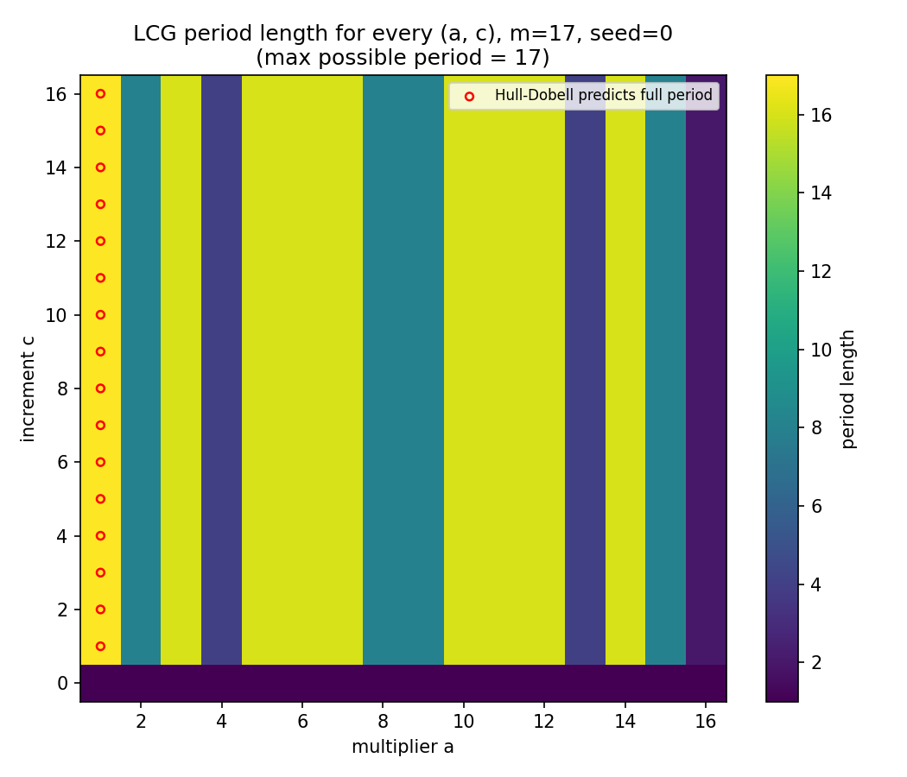
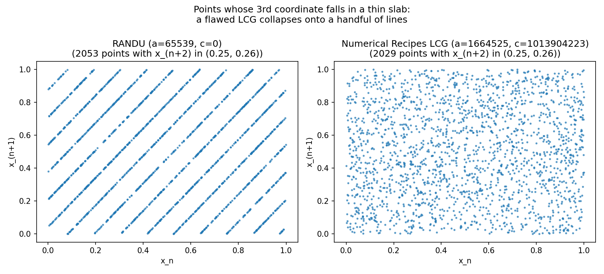

# Linear Congruential Generator: Python, RISC-V, and Why It's a Bad PRNG

A linear congruential generator (LCG) produces pseudo-random numbers with the
recurrence

```
x_(n+1) = (a * x_n + c) mod m
```

This repo implements the LCG twice — once in Python, once in RISC-V assembly
— and then uses the implementation to investigate the two questions that
actually matter for a PRNG: **does it reach full period**, and **is it
statistically well-distributed**? The second question is where it gets
interesting: a generator can pass every simple randomness check and still be
badly broken, which is exactly what happened to IBM's infamous **RANDU**
generator, reproduced here as a cautionary example.

## Repo structure

```
python/lcg.py            minimal, reusable LCG implementation
asm/lcg_riscv.s           same algorithm in RISC-V assembly (targets RARS)
analysis/lcg_analysis.py  period + statistical analysis, generates results/
results/                  generated plots (checked in for convenience)
```

## Running it

### Python

```
python python/lcg.py
```

Runs the toy parameters `a=7, c=3, m=17, seed=6` and prints the generated
sequence and its period.

### RISC-V assembly

`asm/lcg_riscv.s` targets [RARS](https://github.com/TheThirdOne/rars) (RISC-V
Assembler and Runtime Simulator) — it uses RARS's syscall numbers (`a0=1`
print int, `a0=4` print string, `a0=10` exit). Open the file in RARS and
assemble & run; it prints the same sequence as the Python version, space
separated.

### Analysis

```
pip install -r requirements.txt
python analysis/lcg_analysis.py
```

Regenerates everything in `results/` and prints a short report. Takes a few
seconds (it draws ~200k-400k samples from a couple of large-modulus
generators).

## Part A — Does this LCG even reach full period?

A "full period" LCG visits all `m` possible states before repeating. The
[Hull-Dobell theorem](https://en.wikipedia.org/wiki/Linear_congruential_generator#Period_length)
gives exact conditions for that: `gcd(c, m) = 1`, `a - 1` divisible by every
prime factor of `m`, and `a - 1` divisible by 4 if `m` is divisible by 4.

`analysis/lcg_analysis.py` sweeps every `(a, c)` pair for `m = 17` and
measures the actual period, then overlays the pairs Hull-Dobell predicts
should be full period (red circles). The two agree exactly — including a
mismatch worth noting:



**The original assignment's own parameters, `a=7, c=3, m=17`, are *not* full
period** — they only cycle through 16 of the 17 possible states. Hull-Dobell
predicts exactly this (only `a=1` gives full period for a prime `m=17`), and
the direct simulation confirms it. It still "works" as a demo because `a=7`
is invertible mod 17, so the generator is a bijection and the seed `6`
happens to sit on a cycle — it just isn't *the* full cycle.

## Part B — RANDU: passing simple tests while being badly broken

RANDU (`a = 65539`, `c = 0`, `m = 2^31`) was IBM's standard generator through
the 1960s-70s and is the textbook example of how an LCG can look fine in low
dimensions and fail badly in higher ones. Because `a = 65539 = 2^16 + 3`,
`(a - 3)^2 = 2^32 = 2m` exactly, which forces

```
x_(n+2) - 6*x_(n+1) + 9*x_n  ≡  0  (mod m)
```

for *every* triple the generator produces. That identity collapses all
consecutive triples onto a small number of parallel planes in 3D. Slicing a
thin band out of the third coordinate and plotting the other two makes this
visible directly, compared against a well-chosen LCG (Numerical Recipes'
constants) under the identical slice:



Quantitatively: out of 200,000 generated triples, RANDU's land on only **15
distinct planes** — matching the number reported in Marsaglia's original
1968 critique.

## Part C — would a simple test have caught this?

No. Running a chi-square uniformity test and lag-1/lag-2 autocorrelation on
RANDU, the comparison LCG, and Python's own `random.random()` (Mersenne
Twister):

```
generator                            | chi2 p-value | lag-1 r  | lag-2 r
RANDU (a=65539, c=0)                 | p=    0.551  | +0.0008  | +0.0020
Numerical Recipes LCG                | p=    0.392  | -0.0019  | -0.0018
Python random.random() (MT19937)     | p=    0.086  | -0.0025  | -0.0010
```

RANDU passes both checks comfortably. Its flaw only shows up in the 3D
structure from Part B — which is exactly why it went undetected (and used in
production scientific computing) for over a decade. The takeaway: validating
a PRNG requires testing higher-dimensional structure, not just the marginal
distribution.

(The toy `m=17` generator fails the chi-square check in this script, but
that's an artifact of tiling a 16-value cycle into 100k samples across 20
bins, not a meaningful statistical result — it's too small a state space for
the test to be informative.)

## What this demonstrates

- Correctly translating a recurrence into both a high-level language and
  RISC-V assembly, including register allocation and syscall conventions.
- Applying a number-theoretic result (Hull-Dobell) and verifying it against
  direct simulation.
- Reproducing a well-known historical failure (RANDU) from first principles,
  and showing why naive statistical testing misses it.

## Possible extensions

- Implement a proper spectral test (shortest-vector lattice reduction) to
  quantify lattice quality for arbitrary LCGs, not just RANDU's special case.
- Add a non-linear PRNG (xorshift, PCG) in both Python and RISC-V for
  comparison.
